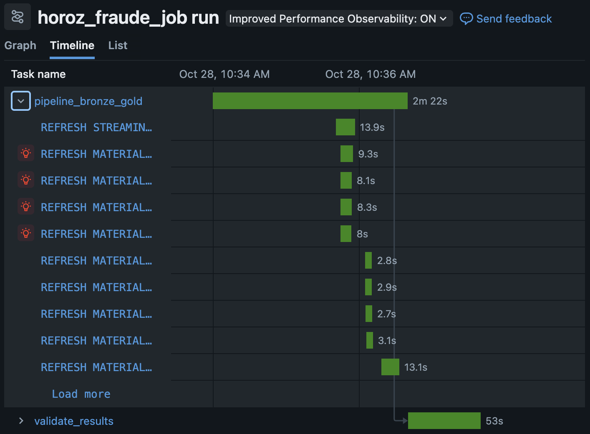
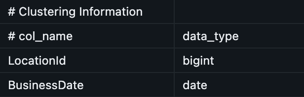
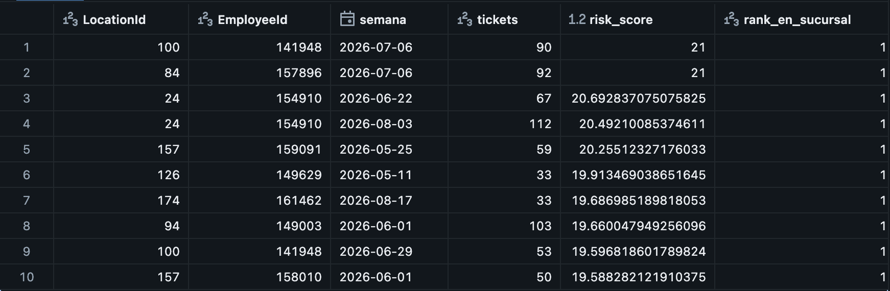

# Applebee's Fraud Detection Pipeline

**Team Horoz** | Sun Holding Challenge | Phase 2

This repository contains the Databricks pipeline we built to turn raw point-of-sale tickets from 127 Applebee's locations into reliable tables for detecting internal fraud: suspicious voids, discounts outside of policy, and tickets where the amount paid does not match what was sold.


---

## 1. The problem

The dataset owners told us their main concern is employee fraud at the point of sale, especially voids on tickets paid in cash. Cash leaves no trail outside the restaurant: if a guest pays in full and an item is voided afterwards, the difference can disappear without anything contradicting it.

The goal of the pipeline is to prepare the data to answer three questions:

- Which tickets do not reconcile between what was sold and what was paid?
- Which employees stand out from their coworkers, week after week?
- Where are the business rules defined by the owners being broken?

The final tables are also the foundation for the fraud model in the next stage of the challenge.

## 2. The data

| | |
|---|---|
| Source | `/Volumes/workspace/default/applebees/Applebees_Challenge/` |
| Tickets | 115 JSON files (one per day), about 11 GB, in `facts/checks/brand=rmh/dt=YYYY-MM-DD/` |
| Reference data | Locations, revenue centers, items and employees in `dimensions/` |
| Period | April 28 to August 20, 2026 |
| Volume | 2,142,846 tickets, 127 locations, 3,187 servers, 84.3 million dollars in net sales |

Each ticket is a nested document with lists of items sold, payments, taxes, discounts and voids. A large part of the pipeline's work is unpacking those lists into columns and tables that can be analyzed.

The data is not stored in this repository because of its size. It lives in the Unity Catalog volume listed above.

## 3. Architecture

We use a medallion architecture with three layers, all stored as Delta tables in `workspace.horoz`.

**Bronze: data exactly as it arrived.** Tickets are ingested with Auto Loader in streaming mode. Auto Loader keeps track of which files it has already read, so each run only processes new ones. Every record gets `source_file` and `ingested_at` columns, so any ticket can be traced back to the file it came from. Reference tables are read in batch because they are small.

**Silver: clean, validated data with business rules.** This layer deduplicates by the ticket key, fixes data types, calculates all money amounts, standardizes inconsistent names and applies the data quality checks.

**Gold: tables ready for analysis and modeling.** Aggregations by day, by employee and by week, plus the list of tickets that need review.

The key idea is that bronze is never modified. If a silver rule changes, the pipeline can recompute everything from bronze without requesting the data again.

## 4. Tables

| Layer | Table | One row is | Purpose |
|---|---|---|---|
| Bronze | `bronze_checks` | a raw ticket | Faithful copy of the source, with lineage |
| Bronze | `bronze_locations`, `bronze_revenue_centers`, `bronze_items`, `bronze_employees` | a reference record | Names of locations, channels, items and employees |
| Silver | `silver_checks` | a ticket | Amounts, tips, payment reconciliation, risk flags and business rules |
| Silver | `silver_items` | an item sold | Detail of what was sold on each ticket |
| Silver | `silver_voids` | a voided item | Standardized void reason, employee and approving manager |
| Silver | `silver_discounts` | a discount | Discount type: employee, manager, loyalty or promotion |
| Gold | `gold_daily_sales` | location + channel + day | Sales trends, tickets, guests and tips |
| Gold | `gold_employee_activity` | employee + location | Summary of each employee over the whole period |
| Gold | `gold_checks_to_review` | a ticket that does not reconcile | Actionable list for audit, with the reason |
| Gold | `gold_employee_weekly_risk` | employee + location + week | Risk score compared against coworkers |

## 5. Main transformations

### Ticket reconciliation

The most important transformation checks that the amount paid matches what was sold. While exploring the data we found that `Payments.Amount` already includes the tip, and that the `Gratuity` field stores that same tip as a negative number. With that, the reconciliation rule is:

```
paid + Gratuity = sales - discounts + taxes + service charge
```

In silver we flip the sign of `Gratuity` to get the tip as a positive number, and we calculate `dif_pago`, the difference between the amount collected without tip and the ticket total. If the difference is under 5 cents, the ticket reconciles.

With this rule, every ticket reconciles except 78 out of 2.14 million. Those 78 are the ones that go to `gold_checks_to_review`.

### Risk flags

In `silver_checks` each ticket is tagged with signals that are later aggregated by employee:

- `tiene_efectivo`: the ticket has at least one cash payment.
- `void_en_efectivo`: there was a void on a ticket paid in cash. Voids have no timestamp, so this flag does not tell whether the void happened before or after payment.
- `is_void_or_comp`: the ticket ended at zero or below, which is typical of full voids or comps.
- `n_desc_empleado`, `n_desc_otros`, `n_voids`: counts used to evaluate the business rules.

In `silver_voids` we separate the void reasons that cannot be verified after payment (`NOT RECVD`, `OTHER`, `WRONG CHK`) from operational ones such as `86'D ITEM` (item out of stock), which leave evidence in the kitchen and in inventory.

### Standardization

Discount names and void categories were written in several ways (`SERV ERR` and `SERVER ERR`, `NOT RECEVD` and `NOT RECVD`, extra spaces, mixed case). Silver standardizes them so counts are not split across variants.

### Weekly risk score

`gold_employee_weekly_risk` compares each employee against their coworkers at the same location in the same week. We compare within the location because each one has its own normal: a different manager, different policies and a different guest volume.

For each of the seven signals we calculate a robust z-score, using the median and the MAD (median absolute deviation) instead of the mean and standard deviation:

```
z = (x - median) / (1.4826 * MAD)
```

We use the robust version because in fraud data the extreme values are exactly the ones that matter. With mean and standard deviation, a very extreme case inflates the scale and hides itself. When the MAD is zero (almost every coworker at zero), we fall back to the mean absolute deviation.

The score only adds upward deviations and caps each signal at 3.5, the classic threshold for an outlier:

```
risk_score = sum over the 7 signals of min(max(z, 0), 3.5)
```

The score ranges from 0 to 24.5 and reads simply: in how many signals, and by how much, an employee stands out from the pattern of their location. Being unusually clean on one signal does not offset being suspicious on another.

## 6. Data quality

The checks live inside the pipeline as Databricks expectations, and their results are stored in the event log, where they can be queried with SQL.


| Table | Rule | What it checks | Failed |
|---|---|---|---|
| `checks_dedup` | `llave_completa` | Ticket has LocationId, BusinessDate and Id (dropped if missing) | 0 |
| `silver_checks` | `horas_validas` | Close time is not earlier than open time | 0 |
| `silver_checks` | `pago_cuadra` | Amount paid reconciles with amount sold | 78 |
| `silver_checks` | `comensales_en_comedor` | Dine-in tickets record at least one guest | 167,559 |
| `silver_checks` | `un_desc_empleado_por_ticket` | At most one employee discount per ticket | 1,105 |
| `silver_checks` | `desc_empleado_no_combinado` | Employee discount is not combined with others | 2,420 |
| `silver_checks` | `void_no_combinado_con_desc` | A ticket with a void has no discounts | 6,879 |
| `silver_items` | `precio_no_negativo` | No item with a negative price | 766 |
| `dq_gate_silver` | `hay_tickets`, `llave_unica`, `estructura_pagos_valida` | Rules on the whole table | 0 |

We use the three kinds of actions on purpose:

- **Drop** (`expect_or_drop`) only for unusable records, such as a ticket without a key.
- **Warn without deleting** (`expect`) for row-level rules. In fraud detection the unusual record is often the evidence, so we do not want to lose it: it is kept, counted and flagged.
- **Stop the pipeline** (`expect_or_fail`) for problems so serious that nothing built on top would make sense. These live in `dq_gate_silver`, a one-row quality gate that checks conditions that cannot be evaluated row by row: that there are tickets at all, that the key is unique across the whole table, and that no more than 1% of tickets fail reconciliation.

The source has no duplicates by key. Even so, silver deduplicates by `LocationId + BusinessDate + Id` as a safeguard in case a file is ever resent.

## 7. Orchestration

The pipeline runs through the job `horoz_fraude_job`, which has two tasks:


1. **`pipeline_bronze_gold`**: updates the full pipeline without a full refresh, so only new files are processed.
2. **`validate_results`**: runs the `Validation` notebook, which displays the `dq_gate_silver` gate (evidence that bronze read files and that the share of tickets that do not reconcile stays below 1%), checks that tickets with negative prices still reconcile, and confirms that the employee in payments matches the employee in items. The actual quality gate with `expect_or_fail` lives inside the pipeline code (`dq_gate_silver`), not in the notebook. It only runs if the first task succeeds.

**Trigger.** The job starts when a new file arrives in `facts/checks/`. Since one file arrives per day, in practice it runs once a day. It waits 5 minutes after the last change so it does not read a file that is still being copied, and keeps at least 60 minutes between runs.

**Failures.** We handle two types:

- Transient failures (compute did not start, a network issue) are covered by one automatic retry after 5 minutes.
- Data failures (a file with a different format, a rule that stops holding) are not fixed by retrying, so the job emails the team. The `source_file` column points to exactly which file caused the problem.

**Reruns.** Auto Loader only marks a file as processed when the run succeeds, so a file that failed is read again on the next run without any manual work. If a silver rule changes, the pipeline supports a full refresh that recomputes everything from bronze.



A run with no new files takes about 3 minutes. Bronze finishes in seconds because there is nothing to read.

## 8. Technical decisions

**Streaming in bronze.** Tickets grow every day, so they are ingested incrementally with Auto Loader. The first load reads the 115 files in batches of 2 (`maxFilesPerTrigger`) to avoid running out of memory on large nested JSON files.

**Materialized views in silver and gold.** They are recomputed when their sources change. On serverless compute, Databricks can refresh them incrementally when the query allows it.

**Reference tables in batch.** Databricks recommends turning the reference tables into streaming tables because their source is not Delta. We decided to keep them in batch: they are small (they recompute in seconds) and, unlike tickets, they do not only grow but also change. An employee can change roles or leave, and reading them as a stream would duplicate records. If they grew, the next step would be to ingest them with Auto Loader and handle changes with AUTO CDC.

**Liquid clustering.** Silver tables are clustered by `LocationId` and `BusinessDate`, and the weekly ranking by `LocationId` and `semana`, because almost every analysis filters by location and date. This lets queries skip files they do not need.



**Serverless compute and triggered mode.** No cluster sizing is needed, it starts in seconds and it only costs while running. The pipeline is in triggered mode because data arrives in batches and the job decides when to run it.

**Separate schema.** Pipeline tables live in `workspace.horoz` and raw data in `workspace.default`, so source and results are not mixed.

## 9. Key findings

**Tickets that do not reconcile.** Of the 78, 45 paid less than what was sold, with a shortfall of 847 dollars, and 33 paid more, by 125 dollars. For the business, the shortfall is what matters. Of those cases, 25 are sales with no payment recorded at all, which account for 608 dollars. The largest one is a 350.96 dollar ticket in Kendallville with nothing collected.

**Voids that cannot be verified.** The reasons `NOT RECVD`, `OTHER` and `WRONG CHK` add up to 26% of the voided amount, about 189 thousand dollars, and they appear more often on cash tickets (55% to 63%) than operational reasons do (39% to 50%, with the generic `VOIDED` category at 67% as an outlier). This is exactly the pattern the owners are worried about.

**Employees with persistent risk.** Employee 149003 at Lima East was in the top 1% riskiest of the whole chain in 14 of 17 weeks worked, and was number 1 at their location in 16. Lima East is also the location with the highest concentration of risk. One bad week can be chance; this level of repetition is a pattern.

**Business rules.** 10,065 tickets break at least one of the owners' rules. The most frequent violation is combining a void with a discount (6,879 tickets). Columbus has the highest rate, with 11.3 violations per thousand tickets, and it also has one of the riskiest employees in the ranking.

**Manager discounts.** The `MANAGER` discount is discretionary and is the one with the highest total: about 367 thousand dollars over the period.

**What drives risk.** In the top 1%, void-related signals explain 57% of the score, rule violations 17%, zero or negative tickets 15% and manager discounts 12%. The strongest cases do not stand out for one thing, but for several at once.



The full detail of these analyses is in the `analysis` notebook.

## 10. Repository structure

- `README.md`: this document.
- `horoz_fraude_pipeline/transformations/`: pipeline code (bronze, silver and gold).
- `Applebees Data Load`: initial data exploration (EDA).
- `data_quality`: data quality review.
- `Validation`: validation that runs as a job task.
- `analysis`: business analysis queries.
- `config/job.yml`: job definition.
- `config/pipeline.yml`: pipeline configuration.
- `docs/`: screenshots of the pipeline, the job and the results.

## 11. How to run it

1. Make sure the data is in `/Volumes/workspace/default/applebees/Applebees_Challenge/`.
2. Create the target schema:
   ```sql
   CREATE SCHEMA IF NOT EXISTS workspace.horoz;
   ```
3. In **Jobs & Pipelines**, create an ETL pipeline using the code in `horoz_fraude_pipeline/transformations/`, catalog `workspace`, schema `horoz`, serverless compute and triggered mode. The full configuration is in `config/pipeline.yml`.
4. Run the pipeline. The first run takes longer because it reads all 115 files; later runs only process new ones.
5. Create the job from `config/job.yml`, or by hand: one Pipeline task and one Notebook task running `Validation` that depends on the first.
6. Open `analysis` and run it to reproduce the findings.

## 12. Assumptions and limitations

- **One server per ticket.** We validated it: no ticket has items from more than one employee, and no void was made by someone other than the ticket's server.
- **No timestamps on voids or payments.** We cannot tell whether a void happened before or after payment, which is why the flag measures "void on a ticket paid in cash".
- **Void approval.** Every void has a manager assigned, so the "void without manager" signal does not separate anyone in this data.
- **Guest counts.** 10.2% of dine-in tickets record no guests (167,559 of 1,649,922), and `TrafficCount` has some fractional values. Guest metrics only use dine-in tickets with at least one guest.
- **Calendar weeks.** The ranking uses weeks starting on Monday; the fiscal calendar is still needed to switch to fiscal periods.
- **Comparison within the location.** If fraud involves the manager or a whole location, comparing against coworkers can hide it. That case needs a comparison across locations.

Still to confirm with the organizers: exactly which discount is the "employee meal", whether `TRAINER` counts as an employee discount, and the fiscal calendar.

## 13. Next steps

- A freshness alert that warns if files stop arriving, since a file arrival trigger simply does not run when nothing arrives.
- Move the ranking from calendar weeks to fiscal periods.
- Replace the "void without manager" signal with one that does discriminate, such as how concentrated a server's approvals are on a single manager, which could point to collusion.
- Ingest the reference tables with Auto Loader and AUTO CDC if they start to grow.
- Use `gold_employee_weekly_risk` as the feature base for the fraud detection model in the next stage.